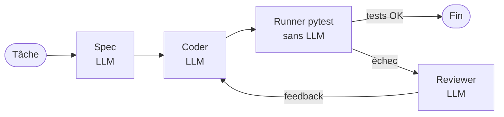

# Développement Agentique

[](https://github.com/chloetch0103/developpement_agentique/actions/workflows/ci.yml)

Chaîne de développement multi-agents construite avec [LangGraph](https://langchain-ai.github.io/langgraph/) :
un agent rédige une spécification, un autre écrit le code, chaque proposition est validée
en exécutant pytest, et un agent relecteur analyse les échecs pour guider la correction.

L'objectif est de **mesurer** la fiabilité de la chaîne : taux de réussite sur un banc
d'essai de tâches, au premier essai et après correction.

> Projet en cours : le graphe et l'exécution des tests sont en place, les agents LLM arrivent.

## Architecture visée



| Nœud | Lit | Écrit | Rôle |
|---|---|---|---|
| `spec` | tâche | spécification | Transforme l'énoncé en spécification précise |
| `coder` | spécification, feedback | code | Écrit le code et ses tests |
| `runner` | code | résultat des tests | Exécute pytest dans un sous-processus isolé, avec timeout |
| `reviewer` | code, résultat | feedback | Analyse l'échec et propose des corrections |

La boucle de correction est limitée à un nombre maximal de tentatives.

## Installation

```bash
python -m venv .venv
.venv\Scripts\Activate.ps1        # Windows (PowerShell)
# source .venv/bin/activate       # macOS / Linux
pip install -e ".[dev]"
```

## Tests

```bash
ruff check .
pytest
```

La CI GitHub Actions lance les mêmes commandes à chaque push et pull request.
Elle n'appelle jamais de vrai LLM.

## Structure

```
src/chain/
├── graph.py      # construction du graphe LangGraph
├── state.py      # état partagé entre les nœuds
└── sandbox.py    # exécution isolée de pytest
tests/            # tests du pipeline
```

## Feuille de route

- [x] Squelette du graphe et boucle de correction
- [x] Exécution isolée de pytest avec timeout
- [ ] Agents LLM (spec, coder, reviewer)
- [ ] Banc d'essai avec tests cachés et mesure du taux de réussite
- [ ] Résultats chiffrés

## Limites

- L'exécution en sous-processus n'est pas un vrai bac à sable de sécurité. Le code généré
  pourrait accéder aux fichiers ou au réseau. Piste : l'exécuter dans un conteneur Docker.
